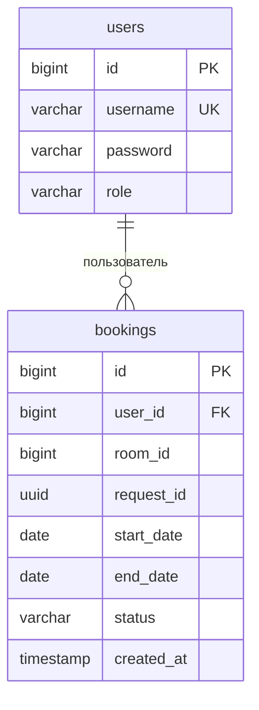

# 🗄️ Database

> `hbs_booking`. База хранит пользователей и историю их бронирований. Liquibase применяет миграции при запуске сервиса.

## 🧩 Диаграмма базы данных

`bookings.room_id` содержит идентификатор номера в базе Hotel Service.

---

## 📋 Таблицы

- [users](users_table.md)
- [bookings](bookings_table.md)

---

## 🧬 Liquibase

Миграции хранятся в `src/main/resources/liquibase`.

- `changelog-master.yaml` подключает `tables/changelog.yaml`.
- `tables/changelog.yaml` перечисляет миграции в порядке создания таблиц.
- У каждой таблицы свой `changelog.yaml` с парой `init_001.sql` и `rollback_001.sql`.
- `init_001.sql` создаёт таблицу и задаёт комментарии к ней и её полям через `comment on`.
- Для изменений после применения миграции добавляется следующая пара SQL-файлов.
